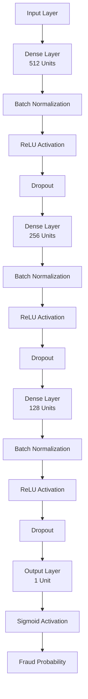

# README.md

```markdown
# Credit Card Fraud Detection: End-to-End Machine Learning Engineering Pipeline

## Advanced Machine Learning System for Fraud Risk Prediction, Model Explainability, and Production-Oriented Deployment


---

# Project Overview

Credit card fraud detection is a challenging machine learning problem due to:

- Extreme class imbalance
- High cost of false negatives
- Need for interpretable predictions
- Requirement for robust generalization on unseen transactions

This project implements a complete end-to-end machine learning workflow for fraud risk prediction following industry-oriented ML engineering practices.

The objective was not only to train a high-performing classifier but to build a reproducible pipeline covering:

- Data analysis
- Feature engineering
- Model development
- Model comparison
- Explainable AI
- Final evaluation
- Model persistence
- Inference pipeline design

---

# Business Problem

Financial institutions process millions of transactions daily, making manual fraud investigation impossible.

The goal of this project is to develop a machine learning system that predicts whether a transaction is fraudulent while balancing:

- Fraud detection capability
- False positive reduction
- Model interpretability
- Operational usability

The final system produces:

1. Fraud probability score
2. Binary fraud classification
3. Explainable prediction insights

---

# Dataset

Dataset:

**IEEE-CIS Fraud Detection Dataset**

The dataset contains anonymized transaction information representing real-world online payment fraud scenarios.

Challenges:

- Highly imbalanced target distribution
- Hundreds of transaction-related features
- Complex nonlinear relationships
- Hidden fraud patterns

---

# Machine Learning Workflow

The project follows a complete ML engineering lifecycle:

```

Data Acquisition
|
|
Exploratory Data Analysis
|
|
Data Cleaning & Preprocessing
|
|
Feature Engineering
|
|
Model Development
|
|
Model Evaluation
|
|
Explainable AI
|
|
Final Testing
|
|
Inference Pipeline

```

---

# Data Processing & Feature Engineering

Implemented preprocessing pipeline including:

## Data Cleaning

- Missing value analysis
- Missing value handling
- Duplicate detection
- Data consistency checks

## Feature Engineering

Developed features to improve fraud detection performance:

- Transaction-level transformations
- Statistical feature analysis
- Numerical feature processing
- Feature scaling
- Encoding strategies

## Class Imbalance Handling

Because fraudulent transactions represent a minority class:

Implemented:

- Class weighting
- Precision-Recall based evaluation
- Threshold optimization

Accuracy alone was avoided because it provides misleading results for highly imbalanced datasets.

---

# Model Development

Multiple machine learning and deep learning approaches were evaluated.

## Classical Machine Learning

Implemented:

| Model | Purpose |
|-|-|
| Logistic Regression | Baseline linear classifier |
| Decision Tree | Nonlinear baseline |
| Random Forest | Ensemble learning |
| XGBoost | Gradient boosting |
| LightGBM | Optimized gradient boosting |
| CatBoost | Alternative boosting approach |

---

## Deep Learning

Developed a fully connected neural network using TensorFlow/Keras.

Architecture:

```





```

Implemented:

- Batch normalization
- Dropout regularization
- L2 regularization
- Early stopping
- Learning rate scheduling
- PR-AUC monitoring

---

# Model Evaluation

Fraud detection requires evaluation beyond accuracy.

Metrics used:

- Accuracy
- Balanced Accuracy
- Precision
- Recall
- F1-score
- ROC-AUC
- PR-AUC

Primary selection metric:

**Precision-Recall AUC (PR-AUC)**

because it better represents performance on highly imbalanced fraud datasets.

---

# Final Model Performance

## Selected Model: LightGBM

| Metric | Score |
|-|-:|
| Accuracy | 0.9708 |
| Balanced Accuracy | 0.5868 |
| Precision | 0.9259 |
| Recall | 0.1742 |
| F1 Score | 0.2932 |
| ROC-AUC | 0.9020 |
| PR-AUC | 0.5264 |

## Interpretation

The final LightGBM model achieved:

- Strong fraud prediction ranking capability
- High precision for flagged transactions
- Robust ROC-AUC performance
- Explainable decision-making

The model prioritizes reducing false fraud alerts while maintaining meaningful fraud detection capability.

---

# Explainable AI (SHAP)

To understand model decisions, SHAP analysis was performed on the final LightGBM model.

Implemented:

## Global Explainability

- SHAP feature importance
- SHAP summary plots
- Feature impact analysis

## Local Explainability

- Individual transaction explanations
- Waterfall plots
- Feature contribution analysis

Example question answered:

> "Why did the model classify this transaction as high risk?"

---

# Model Optimization

Engineering practices implemented:

- Validation-based threshold optimization
- Consistent evaluation framework
- Reusable training pipeline
- Model comparison framework
- Experiment tracking structure

Future optimization:

- Optuna hyperparameter tuning
- Temporal validation
- Model calibration
- Ensemble stacking

---

# Model Deployment Preparation

Implemented production-oriented components:

## Model Persistence

Saved:

- Trained LightGBM model
- Preprocessing artifacts
- Feature schema
- Decision threshold
- Model metadata

## Inference Pipeline

Created reusable prediction interface:

Input:

```

Transaction Features

```

Output:

```

Fraud Probability
Fraud Classification

```

---

# Technology Stack

## Programming

- Python

## Data Science

- Pandas
- NumPy
- Matplotlib
- Seaborn

## Machine Learning

- Scikit-learn
- LightGBM
- XGBoost
- CatBoost

## Deep Learning

- TensorFlow
- Keras

## Explainability

- SHAP

## Development

- Jupyter Notebook
- Git/GitHub

---

# Project Structure

```text
Credit_Card_Fraud_Detection/
│
├── artifacts/
│   ├── feature_names.pkl
│   ├── label_encoders.pkl
│   ├── scaler.pkl
│   └── ...
│
├── catboost_info/
│   └── (CatBoost training logs)
│
├── data/
│   ├── raw/
│   ├── processed/
│   └── Training_Datasets/
│       ├── X_train_scaled.csv
│       ├── X_valid_scaled.csv
│       ├── X_test_scaled.csv
│       ├── X_train_tree.csv
│       ├── X_valid_tree.csv
│       ├── X_test_tree.csv
│       ├── y_train.csv
│       ├── y_valid.csv
│       └── y_test.csv
│
├── models/
│   ├── logistic_regression.pkl
│   ├── random_forest.pkl
│   ├── xgboost.pkl
│   ├── lightgbm.pkl
│   ├── catboost.cbm
│   ├── neural_network.keras
│   └── ...
│
├── Results/
│   ├── figures/
│   ├── metrics/
│   ├── confusion_matrices/
│   ├── roc_curves/
│   └── shap/
│
├── venv/
│
├── 0-Introduction.ipynb
├── 1-Setup and Configuration.ipynb
├── 2-Data and EDA.ipynb
├── 3-Data Cleaning.ipynb
├── 4-Data Preprocessing.ipynb
├── 5-Feature Engineering.ipynb
├── 6-Building Dataset.ipynb
├── 7,8,9-ML Models Training and Evaluation.ipynb
├── 10-Optimize Hyperparameters with Optuna.ipynb
├── 11,12-DL and ML Models Comparison.ipynb
├── 13-Explainable AI (SHAP).ipynb
├── 14-Model Evaluation on Test Set.ipynb
├── 15-Save Model and Inference.ipynb
│
├── utils.py
├── README.md
└── requirements.txt
```

---

# Future Improvements

Potential extensions:

- Optuna-based hyperparameter optimization
- MLflow experiment tracking
- Real-time fraud scoring API
- Docker deployment
- Model monitoring
- Data drift detection
- Automated retraining pipeline
- Advanced tabular transformers

---

# Key Skills Demonstrated

- End-to-end machine learning development
- Fraud analytics
- Feature engineering
- Imbalanced classification
- Gradient boosting models
- Deep learning for tabular data
- Explainable AI
- Model evaluation
- Production ML practices
- Model serialization
- Reproducible workflows
